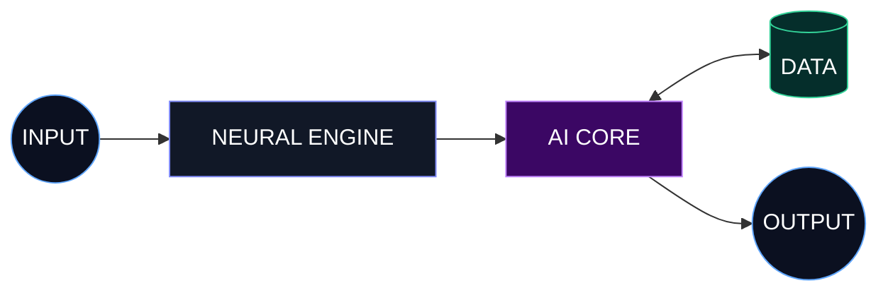



**AI · Software · Automation**

[Portfolio ↗](https://akshat-raj-portfolio-lfy7.vercel.app/) · [Projects ↗](https://github.com/AkshatRaj00?tab=repositories) · [OnePersonAI ↗](https://onepersonai.in)

---

### NEURAL CORE

### Featured builds

[**NeuroBreak AI**](https://github.com/AkshatRaj00/NeuroBreak-AI) · [Heart Disease Prediction](https://github.com/AkshatRaj00/Heart-diseaseprediction) · [Spam Detector](https://github.com/AkshatRaj00/spam-detector)

### Watch / Explore

[Open project demos ↗](https://github.com/AkshatRaj00?tab=repositories)

 

[GitHub](https://github.com/AkshatRaj00) · [X](https://x.com/AkshatRaj00_) · [Email](mailto:akshatgyan2004@gmail.com)

Build. Test. Improve.

