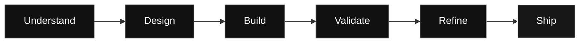

<!-- ======================================================
     AKSHAT RAJ — PREMIUM DEVELOPER PROFILE
     Minimal. Intentional. Engineered.
     ====================================================== -->

  

# Akshat Raj

### Software Engineer in the making.

I build software, explore applied AI, and turn ideas into working products.

 

<a href="https://onepersonai.in">OnePersonAI ↗</a>
&nbsp;&nbsp;·&nbsp;&nbsp;
<a href="https://akshat-raj-portfolio-lfy7.vercel.app/">Portfolio ↗</a>
&nbsp;&nbsp;·&nbsp;&nbsp;
<a href="https://github.com/AkshatRaj00?tab=repositories">Projects ↗</a>

  

 

## About

I'm a Computer Science & Engineering student interested in the intersection of software engineering, AI, and useful digital products.

I prefer understanding the system over memorising the syntax. My process is simple: explore the problem, build a working solution, test the details, and improve what matters.

- **Currently exploring** — AI engineering, backend systems, and open source.
- **Interested in** — Applied machine learning, developer tools, and automation.
- **Building toward** — Software that is useful, reliable, and thoughtfully engineered.

 

## Selected work

A few projects and products from my engineering journey.

<table>
<tr>
<td width="50%" valign="top">

### 01 / NeuroBreak AI

AI-focused project exploring practical applications of intelligent software.

 

<a href="https://github.com/AkshatRaj00/NeuroBreak-AI">Explore repository ↗</a>

</td>
<td width="50%" valign="top">

### 02 / Heart Disease Prediction

A machine-learning project focused on exploring predictive modelling with health-related data.

 

<a href="https://github.com/AkshatRaj00/Heart-diseaseprediction">Explore repository ↗</a>

</td>
</tr>
<tr>
<td width="50%" valign="top">

### 03 / Spam Detector

A classification project exploring automated spam detection.

 

<a href="https://github.com/AkshatRaj00/spam-detector">Explore repository ↗</a>

</td>
<td width="50%" valign="top">

### 04 / GitPatch

An exploration of AI-assisted code workflows and developer productivity.

 

<a href="https://github.com/AkshatRaj00?tab=repositories">Explore repositories ↗</a>

</td>
</tr>
</table>

 

### Products & experiments

| Project | What it explores |
|:--|:--|
| [OnePersonAI](https://onepersonai.in) | Personal AI and intelligent software experiences |
| [KBFixer](https://kbfixer.onepersonai.in) | Browser-based file utilities |
| [OneMusic](https://onemusic-website.vercel.app/) | Music-focused digital experience |
| [Cutout Studio](https://cutout.onepersonai.in) | Image background-removal utility |
| OmniPrice | Multi-store product discovery and price-comparison concept |

Project links, features, and implementation status may change. Explore each project for its current state.

 

## Engineering approach

Good software is not just a working demo. It's a system someone else can understand, test, and improve.

I value clear interfaces, understandable code, meaningful tests, secure configuration, and focused changes.

 

## Tools I work with

**Languages**

  

**Web & backend**

  

**AI & development**

Technologies represent areas I use or explore; experience and proficiency vary across the stack.

 

## GitHub activity

  

 

## Beyond the code

I believe in learning by building, staying curious, and improving through honest feedback.

My long-term goal is to become an engineer who can move comfortably from understanding a problem to designing, implementing, and maintaining a real solution.

 

  

### Let's build something meaningful.

Open to interesting engineering conversations and meaningful open-source collaboration.

 

<a href="https://github.com/AkshatRaj00">GitHub</a>
&nbsp;&nbsp;·&nbsp;&nbsp;
<a href="https://x.com/AkshatRaj00_">X</a>
&nbsp;&nbsp;·&nbsp;&nbsp;
<a href="https://dev.to/akshatraj00">DEV Community</a>
&nbsp;&nbsp;·&nbsp;&nbsp;
<a href="https://www.kaggle.com/akshatraj12">Kaggle</a>

  

<a href="mailto:akshatgyan2004@gmail.com">akshatgyan2004@gmail.com</a>

  

Designed with intention. Built through iteration.

  

