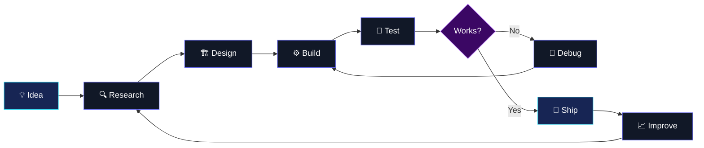
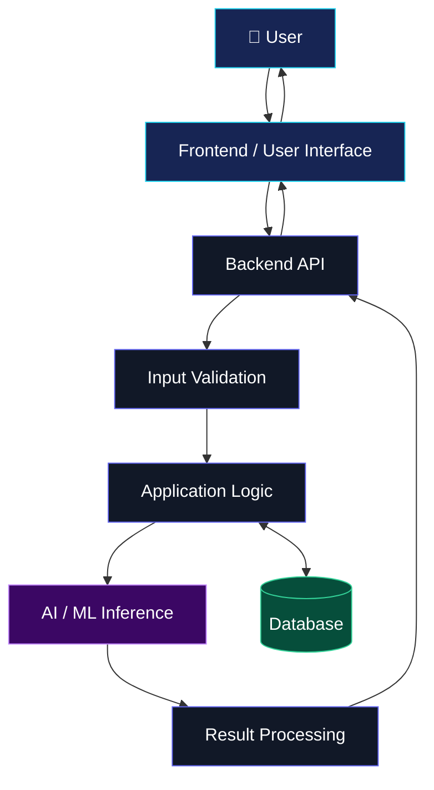
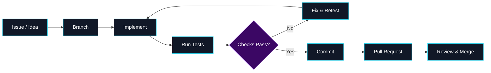

<!-- =========================================================
     AKSHAT RAJ | PREMIUM GITHUB PROFILE
     Repository: AkshatRaj00/AkshatRaj00
     ========================================================= -->

<div align="center">

<a href="https://github.com/AkshatRaj00">
  
</a>

<br/>

<a href="https://readme-typing-svg.demolab.com">
  
</a>

<br/><br/>

<a href="https://onepersonai.in">
  
</a>
<a href="https://akshat-raj-portfolio-lfy7.vercel.app/">
  
</a>
<a href="https://github.com/AkshatRaj00?tab=repositories">
  
</a>

<br/><br/>

*Computer Science student building software at the intersection of AI, automation, and practical engineering.*

</div>

---

## `01` — About Me

```text
Name       Akshat Raj
Focus      AI Engineering · Software Development
Interests  Applied AI · Backend Systems · Automation
Approach   Learn → Build → Test → Improve → Ship
Goal       Build useful products and contribute to open source
```

I'm a Computer Science & Engineering student interested in turning technical ideas into practical software. I enjoy experimenting with AI-powered applications, building developer tools, exploring backend architecture, and contributing to open-source projects.

- Building and improving real-world software projects.
- Exploring machine learning, NLP, computer vision, and AI applications.
- Learning about reliable APIs, software architecture, and automation.
- Improving through hands-on development and open-source collaboration.

> My philosophy: Build things that work. Understand why they work. Keep making them better.

## `02` — Engineering Mindset

<div align="center">



</div>

I aim to focus on working implementations, clear architecture, meaningful tests, and maintainable code—not just attractive demos.

## `03` — Technology Stack

<div align="center">

### Languages


### Web & Backend


### AI, Data & Computer Vision


### Developer Tools


</div>

**Current direction:** Strengthening Python, AI/ML fundamentals, backend development, software testing, and open-source engineering.

*The icons represent technologies I work with or explore; proficiency varies by technology.*

## `04` — Selected Projects

<div align="center">

<a href="https://github.com/AkshatRaj00/NeuroBreak-AI">
  
</a>
<a href="https://github.com/AkshatRaj00/Heart-diseaseprediction">
  
</a>
<a href="https://github.com/AkshatRaj00/spam-detector">
  
</a>

</div>

### Other engineering projects

| Project | Focus |
|---|---|
| **OnePersonAI** | Personal AI assistant and AI-powered software experiments |
| **KBFixer** | Browser-based file utility and compression |
| **OneMusic** | Music-focused application and web experience |
| **Cutout Studio** | Image background-removal utility |
| **GitPatch** | AI-assisted code and document workflow experiments |
| **OmniPrice** | Multi-store product discovery and price-comparison concept |

Explore the [GitHub repositories](https://github.com/AkshatRaj00?tab=repositories) for source code, current implementations, and project-specific documentation.

*Project descriptions are summaries; check each repository for its current features, implementation status, and setup instructions.*

## `05` — System Architecture

An example of how I approach an AI-powered application. The actual architecture depends on the project.

<div align="center">



</div>

**Engineering priorities**

- Clear boundaries between the frontend, API, business logic, and data layer.
- Input validation and meaningful error handling.
- Secure configuration and environment-variable management.
- Tests for important behavior and edge cases.
- Documentation that helps another developer run the project.

## `06` — Development Workflow

<div align="center">



</div>

My goal is to make contributions understandable, reproducible, and easy to review. I value focused changes, clear commit messages, and tests that demonstrate the intended behavior.

## `07` — GitHub Activity

<div align="center">


<br/>


<br/>


</div>

## `08` — Open Source

I am interested in contributing to projects where I can understand the codebase, reproduce issues, write focused fixes, and help improve reliability.

My preferred contribution workflow:

1. Understand the issue and expected behavior.
2. Reproduce the problem with a minimal example.
3. Trace the relevant implementation.
4. Write a focused fix and regression test.
5. Run relevant tests and document the result.
6. Submit a clear pull request.

[Explore my repositories and contributions →](https://github.com/AkshatRaj00)

## `09` — Beyond the Code

- **Curiosity:** Explore how systems work beneath the interface.
- **Consistency:** Improve through small, practical steps.
- **Ownership:** Understand the code before claiming a solution.
- **Collaboration:** Share useful context and welcome constructive reviews.
- **Quality:** Prefer maintainable solutions over unnecessary complexity.

## `10` — Connect

<div align="center">

<a href="https://github.com/AkshatRaj00">
  
</a>
<a href="https://onepersonai.in">
  
</a>
<a href="https://akshat-raj-portfolio-lfy7.vercel.app/">
  
</a>
<a href="https://x.com/AkshatRaj00_">
  
</a>
<a href="https://dev.to/akshatraj00">
  
</a>
<a href="https://www.kaggle.com/akshatraj12">
  
</a>

<br/><br/>

For collaboration, technical discussions, or project inquiries:

**[akshatgyan2004@gmail.com](mailto:akshatgyan2004@gmail.com)**

<br/>

*Open to learning, building, and meaningful open-source collaboration.*

<br/>


</div>

<!-- End of profile README -->
