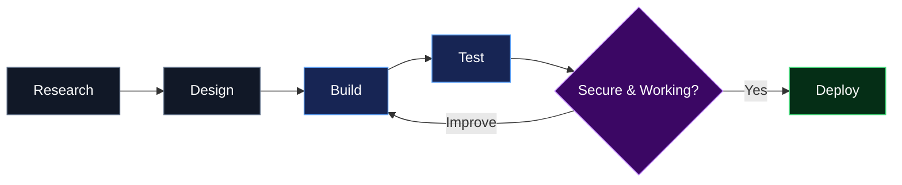



<h1>Akshat Raj</h1>

### AI Engineer · Web Developer · Cybersecurity Enthusiast

Building intelligent systems, modern web applications, and exploring how to make software more secure.

<a href="https://github.com/AkshatRaj00?tab=repositories">Projects</a> ·
<a href="https://akshat-raj-portfolio-lfy7.vercel.app/">Portfolio</a> ·
<a href="https://onepersonai.in">OnePersonAI</a> ·
<a href="mailto:akshatgyan2004@gmail.com">Contact</a>

 

---

## About Me

- 🤖 **AI Engineering:** Machine learning, NLP, computer vision, and AI-powered applications.
- 🌐 **Web Development:** React, Next.js, Node.js, APIs, and database-backed applications.
- 🛡️ **Cybersecurity:** Learning networking, Linux, application security, and ethical security testing.
- ⚙️ **Engineering:** Python, automation, debugging, testing, and open-source development.
- 🚀 **Building:** [OnePersonAI](https://onepersonai.in) and practical software projects.

## Technology Stack

### Artificial Intelligence & Data

### Web Development

### Databases & Backend

### Programming Languages

### Cybersecurity & Systems

### Development Tools & Deployment

Stack includes tools I use or am learning. Listing a technology does not imply expert-level proficiency.

---

## Featured Projects

<table>
<tr>
<td width="50%" valign="top">

### NeuroBreak AI

AI-focused project.

[View repository ↗](https://github.com/AkshatRaj00/NeuroBreak-AI)

</td>
<td width="50%" valign="top">

### Heart Disease Prediction

Machine-learning prediction project.

[View repository ↗](https://github.com/AkshatRaj00/Heart-diseaseprediction)

</td>
</tr>
<tr>
<td width="50%" valign="top">

### Spam Detector

Spam classification project.

[View repository ↗](https://github.com/AkshatRaj00/spam-detector)

</td>
<td width="50%" valign="top">

### More Experiments

Explore my other software, AI, and developer-tool projects.

[Browse repositories ↗](https://github.com/AkshatRaj00?tab=repositories)

</td>
</tr>
</table>

## Engineering Workflow

## GitHub Activity

  

---

## Connect With Me

  

**Build intelligently. Develop responsibly. Secure by design.**

