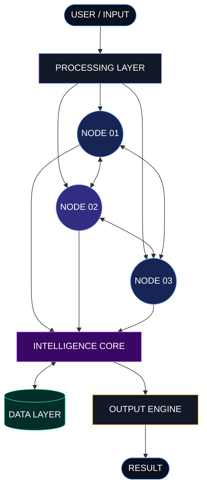
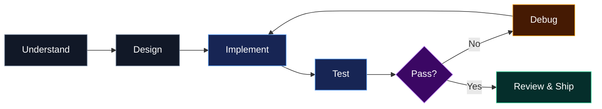



 

# AKSHAT RAJ

**Software Engineering · Applied AI · Open Source**

Building practical software at the intersection of intelligent systems and engineering.

[Portfolio ↗](https://akshat-raj-portfolio-lfy7.vercel.app/) · [OnePersonAI ↗](https://onepersonai.in) · [Repositories ↗](https://github.com/AkshatRaj00?tab=repositories)

 

## / 01 — The Mission

I'm a Computer Science & Engineering student exploring applied AI, backend systems, automation, and developer tools.

I believe in understanding the problem before writing the solution, testing what I build, and keeping software understandable for the next engineer.

`RESEARCH` → `DESIGN` → `BUILD` → `VALIDATE` → `IMPROVE`

## / 02 — Neural Systems

*Conceptual architecture illustrating an AI-enabled application, not a claim that every project uses this exact system.*

## / 03 — Selected Work

<table>
<tr>
<td width="50%" valign="top">

### NeuroBreak AI

An AI-focused project exploring practical intelligent software.

[View repository ↗](https://github.com/AkshatRaj00/NeuroBreak-AI)

</td>
<td width="50%" valign="top">

### Heart Disease Prediction

Machine-learning experimentation with predictive modelling.

[View repository ↗](https://github.com/AkshatRaj00/Heart-diseaseprediction)

</td>
</tr>
<tr>
<td width="50%" valign="top">

### Spam Detector

A classification project exploring automated spam detection.

[View repository ↗](https://github.com/AkshatRaj00/spam-detector)

</td>
<td width="50%" valign="top">

### GitPatch & Developer Tools

Exploring AI-assisted workflows and practical developer utilities.

[Explore repositories ↗](https://github.com/AkshatRaj00?tab=repositories)

</td>
</tr>
</table>

### Product experiments

| Project | Focus |
|:--|:--|
| [OnePersonAI](https://onepersonai.in) | Personal AI and intelligent software |
| [KBFixer](https://kbfixer.onepersonai.in) | Browser-based file utilities |
| [OneMusic](https://onemusic-website.vercel.app/) | Music-focused digital experience |
| [Cutout Studio](https://cutout.onepersonai.in) | Image background-removal utility |
| OmniPrice | Multi-store product discovery concept |

## / 04 — Engineering Stack

**LANGUAGES**

**WEB / BACKEND**

**AI / DEVELOPER TOOLS**

These are technologies I use or explore; experience varies across the stack.

## / 05 — Development Protocol

- Clear interfaces and maintainable implementation.
- Input validation, error handling, and secure configuration.
- Focused changes with relevant regression tests.
- Documentation that makes projects easier to run and understand.

## / 06 — GitHub Telemetry

  

## / 07 — Connect

[GitHub](https://github.com/AkshatRaj00) · [Portfolio](https://akshat-raj-portfolio-lfy7.vercel.app/) · [OnePersonAI](https://onepersonai.in) · [X](https://x.com/AkshatRaj00_) · [DEV](https://dev.to/akshatraj00) · [Kaggle](https://www.kaggle.com/akshatraj12)

[akshatgyan2004@gmail.com](mailto:akshatgyan2004@gmail.com)

 

*Thoughtful engineering. Continuous iteration.*

